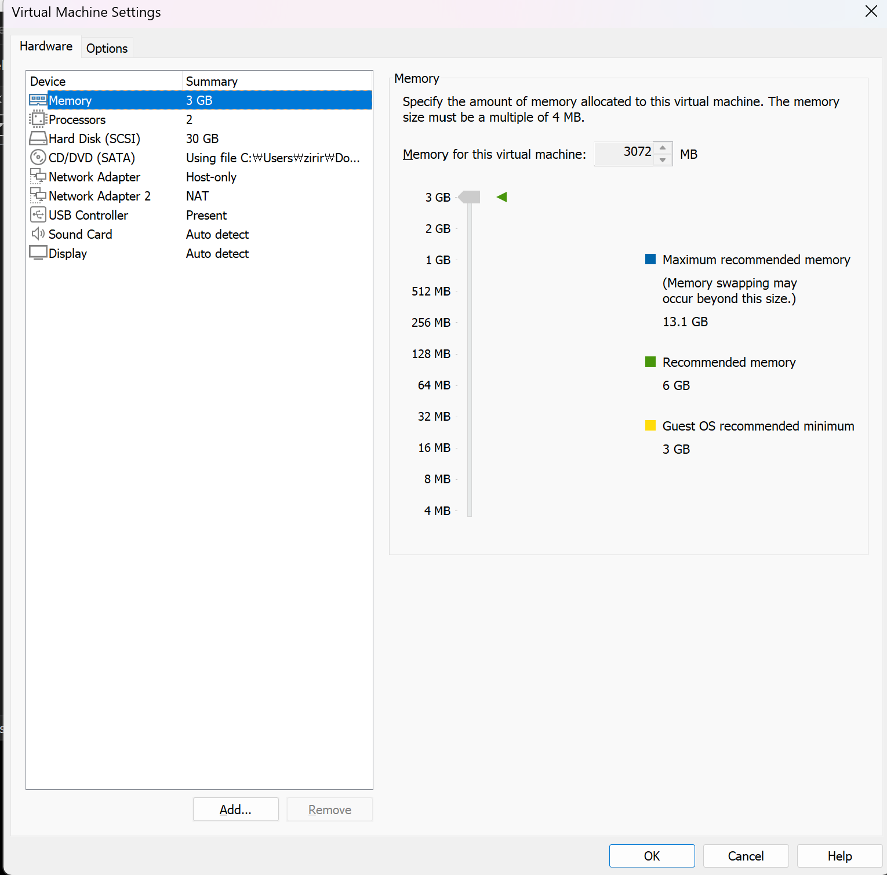

# 01. VMware 기반 Ubuntu Server 구축

## 1. 실습 목적

VMware Workstation Pro를 활용하여 Ubuntu Server 24.04 LTS 가상 서버를 구축하고, 가상화 환경에서 서버 리소스를 구성하는 방법을 학습한다.

## 2. 실습 환경

| 항목 | 설정 |
|---|---|
| 가상화 플랫폼 | VMware Workstation Pro |
| 운영체제 | Ubuntu Server 24.04 LTS |
| CPU | 2 vCPU |
| 메모리 | 3GB |
| 가상 디스크 | 30GB |

## 3. 구축 과정

### 3.1 가상머신 생성

1. VMware Workstation Pro에서 새 가상머신 생성
2. Ubuntu Server 24.04 설치 ISO 이미지 선택
3. 가상머신 CPU 및 메모리 설정
4. 30GB 가상 디스크 할당
5. Ubuntu Server 설치 진행

### 3.2 Ubuntu Server 설치

- Ubuntu Server 24.04 LTS 설치
- 관리자용 사용자 계정 생성
- 서버 부팅 및 로그인 확인

### 3.3 시스템 정보 확인

운영체제 버전 확인:

```bash
lsb_release -a
```

CPU 정보 확인:

```bash
lscpu
```

메모리 확인:

```bash
free -h
```

디스크 확인:

```bash
lsblk
```

## 4. 검증 방법

- Ubuntu Server 정상 부팅 확인
- 운영체제 버전 확인
- CPU 및 메모리 할당 상태 확인
- 가상 디스크 인식 상태 확인

## 5. 학습 내용

VMware에서 가상 서버를 생성하고 Ubuntu Server를 설치하는 과정을 통해 가상화 기반 서버 구축의 기본 흐름을 이해했다.

가상머신에 CPU, 메모리, 디스크 자원을 할당하고 Linux 명령어를 이용해 시스템 정보를 확인하는 방법을 학습했다.

## 6. VMware 가상머신 설정 검증



VMware Workstation Pro에서 CPU 2 vCPU,
메모리 3GB, 디스크 30GB를 할당하고
Host-only 및 NAT 네트워크 어댑터를
구성한 것을 확인했습니다.
