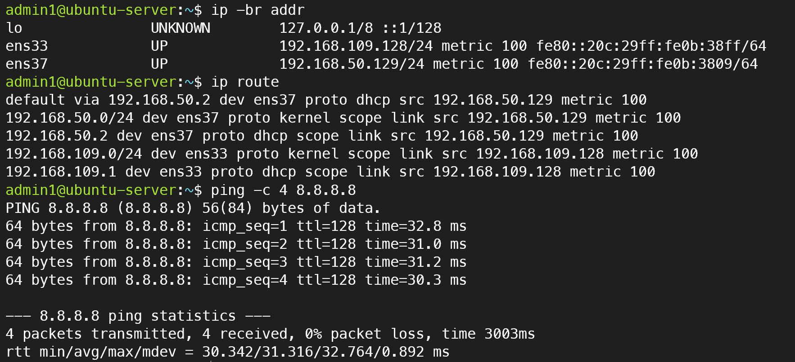
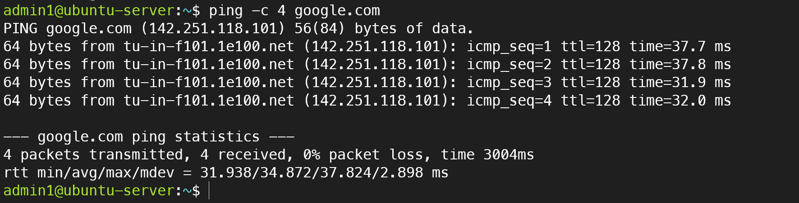

# 03. VMware Linux 네트워크 구성 및 통신 검증

## 1. 실습 목적

VMware Workstation Pro 환경에서 Ubuntu Server에 Host-only 및 NAT 네트워크 인터페이스를 구성하고, IP 주소와 라우팅 테이블을 확인하여 외부 네트워크 통신을 검증한다.

## 2. 실습 환경

| 항목 | 설정 |
|---|---|
| 가상화 플랫폼 | VMware Workstation Pro |
| 운영체제 | Ubuntu Server 24.04 LTS |
| Host-only 인터페이스 | ens33 |
| Host-only IP | 192.168.109.128/24 |
| NAT 인터페이스 | ens37 |
| NAT IP | 192.168.50.129/24 |
| 기본 게이트웨이 | 192.168.50.2 |

## 3. 네트워크 구성

### Host-only 네트워크

호스트 PC와 Ubuntu 가상머신 사이의 내부 통신을 위한 네트워크이다. 외부 네트워크와 분리된 실습 환경을 구성하는 데 활용한다.

### NAT 네트워크

가상머신이 VMware NAT 기능을 이용하여 외부 네트워크와 통신할 수 있도록 구성한 네트워크이다.

## 4. 네트워크 검증

### 4.1 IP 주소 확인

```bash
ip -br addr
```

검증 결과:

- ens33: 192.168.109.128/24 (UP)
- ens37: 192.168.50.129/24 (UP)

### 4.2 라우팅 테이블 확인

```bash
ip route
```

기본 라우팅 경로:

```text
default via 192.168.50.2 dev ens37
```

외부 목적지로 향하는 기본 경로가 NAT 인터페이스를 사용하도록 설정된 것을 확인했다.

### 4.3 외부 네트워크 통신 확인

```bash
ping -c 4 8.8.8.8
```

검증 결과:

| 항목 | 결과 |
|---|---|
| 전송 패킷 | 4 |
| 수신 패킷 | 4 |
| 패킷 손실률 | 0% |
| 평균 응답 시간 | 약 31.3ms |

외부 IP 주소로 ICMP 패킷을 전송하여 정상적인 응답을 확인했다.

## 5. 학습 내용

- Host-only와 NAT 네트워크의 차이점 이해
- Linux 네트워크 인터페이스 및 IP 주소 확인
- 기본 게이트웨이와 라우팅 테이블 이해
- Ping을 이용한 외부 네트워크 연결 검증

Host-only와 NAT 인터페이스를 분리하여 서버 관리용 내부 통신과 외부 네트워크 접근을 구분하는 실습을 수행했다.

## 6. 네트워크 구성 및 통신 검증 화면



`ip -br addr` 명령어로 Host-only 및 NAT
인터페이스의 IP 주소를 확인하고,
`ip route` 명령어로 기본 게이트웨이가
NAT 인터페이스에 설정된 것을 검증했다.

또한 `ping -c 4 8.8.8.8` 명령어를
실행하여 패킷 손실률 0%로
외부 IP 통신에 성공했다.


## 7. DNS 이름 해석 및 외부 통신 검증

```bash
ping -c 4 google.com
```



### 검증 결과

Google 도메인에 대한 DNS 이름 해석이 정상적으로 수행되었으며, `ping -c 4 google.com` 명령어 실행 결과 패킷 4개 송신 및 4개 수신, 패킷 손실률 0%를 확인했습니다.

이를 통해 Ubuntu Server에서 DNS 이름 해석과 외부 네트워크 통신이 정상적으로 동작함을 검증했습니다.
