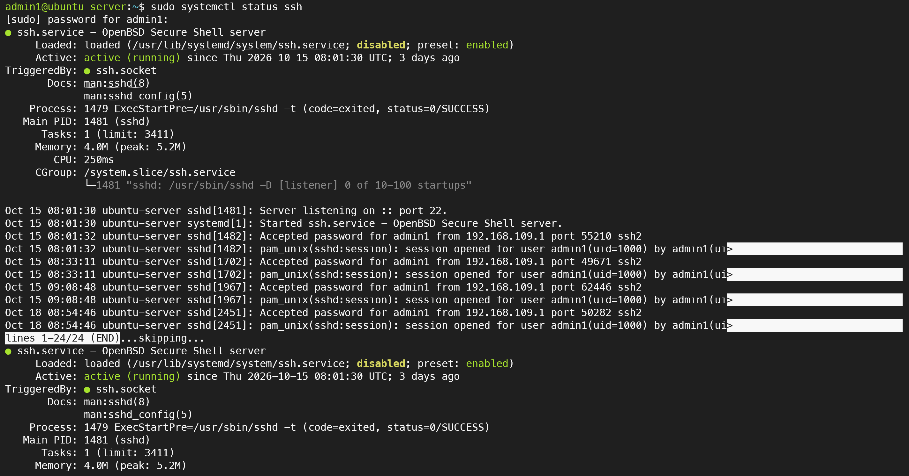
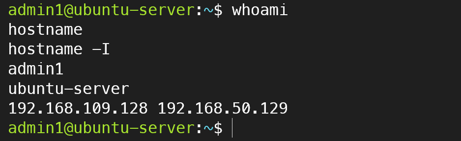

# 04. SSH 원격 접속 및 서비스 관리

## 1. 실습 목적
VMware Workstation Pro 기반 Ubuntu Server 24.04 LTS 환경에서 OpenSSH 서비스를 확인하고, SSH를 이용한 원격 서버 관리 방법을 학습한다.

## 2. 실습 환경

| 항목 | 설정 |
|---|---|
| 가상화 플랫폼 | VMware Workstation Pro |
| 운영체제 | Ubuntu Server 24.04.3 LTS |
| 서버 호스트명 | ubuntu-server |
| 접속 계정 | admin1 |
| Host-only IP | 192.168.109.128/24 |
| NAT IP | 192.168.50.129/24 |
| SSH 포트 | TCP 22 |
| SSH 서비스 | OpenSSH Server |

## 3. SSH 서비스 상태 확인

```bash
sudo systemctl status ssh
```

확인 결과:
- SSH 서비스: active (running)
- SSH 서버가 TCP 22번 포트에서 연결 대기
- systemd 서비스 상태 및 SSH 접속 로그 확인
- ssh.service는 disabled로 표시되었으며 ssh.socket에 의해 트리거되는 구성 확인

## 4. SSH 원격 접속

Windows PowerShell에서 Ubuntu Server의 Host-only IP를 대상으로 SSH 접속한다.

```powershell
ssh admin1@192.168.109.128
```

SSH 서버 로그에서 admin1 계정의 비밀번호 인증 성공 기록을 확인하였다.

```text
Accepted password for admin1 from 192.168.109.1
```

## 5. 접속 후 서버 정보 검증

```bash
whoami
hostname
hostname -I
```

검증 결과:

```text
admin1
ubuntu-server
192.168.109.128 192.168.50.129
```

## 6. 실습 결과

| 검증 항목 | 결과 |
|---|---|
| SSH 서비스 실행 | 성공 |
| TCP 22번 포트 리스닝 | 확인 |
| SSH 인증 성공 로그 | 확인 |
| 사용자 계정 확인 | admin1 |
| 서버 호스트명 확인 | ubuntu-server |
| 서버 IP 확인 | Host-only 및 NAT IP 확인 |

## 7. 실습 증빙 자료

SSH 서비스 상태 및 원격 접속 검증 화면을 첨부한다.





## 8. 학습 내용

- SSH를 이용한 Linux 서버 원격 관리 원리 이해
- systemctl을 활용한 서비스 상태 확인
- SSH 접속 인증 로그 확인
- Host-only 네트워크를 이용한 관리용 접속 경로 이해
- Linux 명령어를 통한 사용자, 호스트명 및 IP 주소 검증

## 9. 운영 관점에서 고려할 사항

실제 운영 환경에서는 SSH 키 기반 인증, 최소 권한 계정 사용, 방화벽 접근 제한, 접속 로그 모니터링 등을 적용하여 보안을 강화해야 한다.
