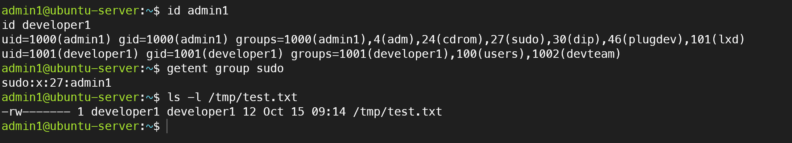
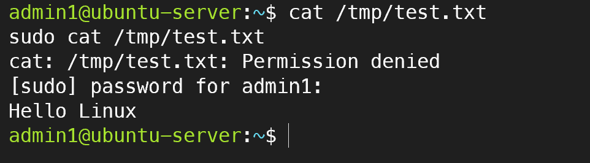

# 05. Linux 사용자·그룹 및 파일 권한 관리

## 1. 실습 목적

Ubuntu Server 환경에서 사용자 및 그룹을 관리하고, Linux 파일 권한과 소유권 설정을 통해 접근 제어 원리를 이해한다.

일반 사용자와 관리자 권한의 차이를 확인하고, 최소 권한 원칙을 적용하는 실습을 수행한다.

## 2. 실습 환경

| 항목 | 구성 |
|---|---|
| 가상화 플랫폼 | VMware Workstation Pro |
| 운영체제 | Ubuntu Server 24.04 LTS |
| 관리자 계정 | admin1 |
| 일반 사용자 계정 | developer1 |
| 개발 그룹 | devteam |
| 실습 파일 | /tmp/test.txt |

## 3. 사용자 및 그룹 관리

사용자별 UID, GID 및 소속 그룹을 확인하였다.

```bash
id admin1
id developer1
getent group sudo
```

확인 결과:
- admin1: UID 1000, sudo 그룹 소속
- developer1: UID 1001, devteam 그룹 소속
- sudo 그룹 구성원: admin1

관리자 계정과 일반 사용자 계정의 권한을 구분하여 관리하였다.

## 4. 파일 소유권 및 접근 권한 확인

```bash
ls -l /tmp/test.txt
```

확인 결과:

```text
-rw------- 1 developer1 developer1 12 Oct 15 09:14 /tmp/test.txt
```

파일 소유자는 developer1이며, 권한은 600으로 설정되어 있다.

| 구분 | 권한 | 설명 |
|---|---|---|
| 소유자 | rw- | 읽기 및 쓰기 가능 |
| 그룹 | --- | 접근 불가 |
| 기타 사용자 | --- | 접근 불가 |

파일 소유자에게만 읽기 및 쓰기 권한을 허용하여 일반 사용자의 무단 접근을 제한하였다.

## 5. 일반 사용자 및 관리자 접근 제어 검증

일반 사용자 권한으로 파일 읽기를 시도하였다.

```bash
cat /tmp/test.txt
```

실행 결과:

```text
cat: /tmp/test.txt: Permission denied
```

sudo 권한으로 동일한 파일을 읽었다.

```bash
sudo cat /tmp/test.txt
```

실행 결과:

```text
Hello Linux
```

일반 사용자에게는 접근이 거부되었지만 sudo를 통한 관리자 권한으로는 파일을 읽을 수 있음을 확인하였다.

## 6. 실습 검증 결과

| 검증 항목 | 결과 |
|---|---|
| 관리자 계정 확인 | 성공 |
| 일반 사용자 계정 확인 | 성공 |
| sudo 그룹 확인 | 성공 |
| devteam 그룹 확인 | 성공 |
| 파일 소유권 확인 | 성공 |
| 파일 권한 600 확인 | 성공 |
| 일반 사용자 접근 제한 | 성공 |
| sudo 관리자 접근 | 성공 |

## 7. 실습 증빙 자료

### 사용자·그룹 및 파일 권한 확인

사용자 UID, GID, 소속 그룹과 파일 소유권 및 접근 권한을 확인하였다.



### 일반 사용자 접근 제한 및 sudo 권한 검증

일반 사용자 접근 거부와 관리자 권한을 이용한 파일 읽기 성공을 확인하였다.



## 8. 학습 내용

- Linux 사용자 계정과 UID, GID의 개념 이해
- 사용자 그룹 및 sudo 권한 관리 방법 학습
- chmod를 이용한 파일 권한 설정 이해
- chown을 이용한 파일 소유권 관리 이해
- 일반 사용자와 관리자 권한의 차이 확인
- 최소 권한 원칙에 따른 파일 접근 제어 이해

## 9. 운영 관점에서 고려할 사항

실제 서버 운영 환경에서는 업무에 필요한 최소한의 권한만 사용자에게 부여해야 한다.

sudo 권한은 관리자에게만 제한적으로 부여하고, 파일 소유권과 접근 권한을 정기적으로 점검해야 한다.

또한 중요 파일의 접근 기록과 권한 변경 이력을 관리하여 보안 사고를 예방해야 한다.
