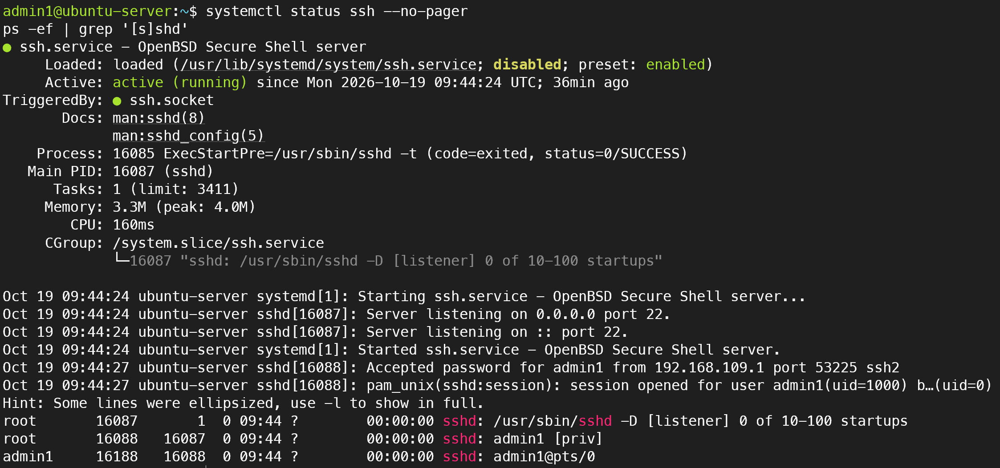
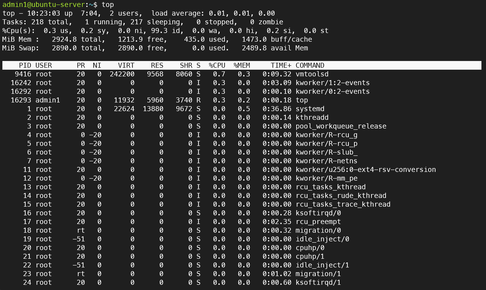
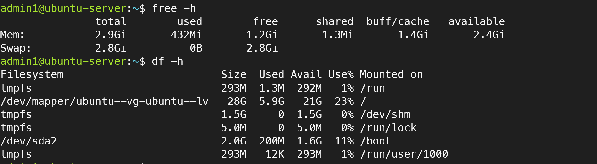
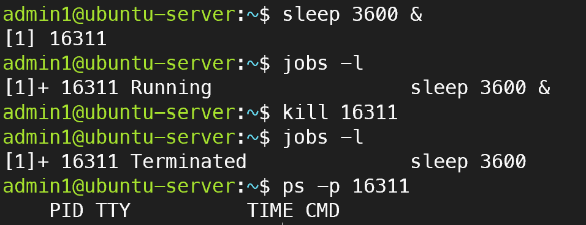

# 06. Linux 프로세스 관리 및 시스템 리소스 모니터링

## 1. 실습 목적
Ubuntu Server 환경에서 실행 중인 프로세스와 서비스 상태를 확인하고, CPU·메모리·디스크 사용량을 모니터링한다. 백그라운드 프로세스를 생성하고 종료한 뒤 실제 종료 여부를 검증한다.

## 2. 실습 환경

| 항목 | 설정 |
|---|---|
| 가상화 플랫폼 | VMware Workstation Pro |
| 운영체제 | Ubuntu Server 24.04 LTS |
| 사용자 | admin1 |
| 서버 호스트명 | ubuntu-server |
| 관리 접속 | SSH (Host-only 네트워크) |

## 3. SSH 서비스 및 프로세스 확인

```bash
systemctl status ssh --no-pager
ps -ef | grep '[s]shd'
```

SSH 서비스의 active (running) 상태를 확인하고, sshd 리스너 및 SSH 접속 세션 관련 프로세스를 확인하였다.



## 4. CPU 및 프로세스 모니터링

```bash
top
```

CPU 사용률, 시스템 부하(load average), 전체 프로세스 수와 각 프로세스의 자원 사용량을 확인하였다.



## 5. 메모리 및 디스크 사용량 확인

```bash
free -h
df -h
```

확인한 주요 결과:
- 물리 메모리: 약 2.9GiB
- 사용 가능한 메모리(available): 약 2.4GiB
- Swap: 약 2.8GiB, 사용량 0
- 루트 파일시스템: 28G 중 약 5.9G 사용, 사용률 23%



## 6. 백그라운드 프로세스 생성 및 종료

### 6.1 프로세스 생성
```bash
sleep 600 &
jobs -l
```

백그라운드 작업으로 sleep 프로세스를 실행하고 PID 16265가 Running 상태임을 확인하였다.

### 6.2 프로세스 종료
```bash
kill 16311
jobs -l
ps -p 16311
```

kill 명령어로 SIGTERM 종료 신호를 전송하였다. jobs -l에서 Terminated 상태를 확인하였으며, ps -p 16311 결과에 프로세스가 나타나지 않아 종료를 검증하였다.



## 7. 실습 결과

| 검증 항목 | 결과 |
|---|---|
| SSH 서비스 상태 확인 | 성공 |
| SSH 프로세스 조회 | 성공 |
| CPU 및 프로세스 모니터링 | 성공 |
| 메모리 및 디스크 사용량 확인 | 성공 |
| 백그라운드 프로세스 생성 | 성공 |
| SIGTERM을 통한 프로세스 종료 | 성공 |
| 프로세스 종료 여부 검증 | 성공 |

## 8. 학습 내용
- systemctl을 활용한 서비스 상태 확인
- ps와 grep을 활용한 프로세스 검색
- top을 통한 실시간 시스템 모니터링
- free와 df를 통한 메모리·파일시스템 사용량 확인
- 백그라운드 작업과 PID의 개념 이해
- kill과 SIGTERM을 통한 프로세스 종료 및 검증

## 9. 운영 관점에서 고려할 사항
실제 서버 운영에서는 프로세스 종료 전 PID와 서비스 영향 범위를 확인해야 한다. SIGTERM을 통한 정상 종료를 우선 고려하고, 서비스 장애가 발생하면 상태와 로그를 확인한 후 조치해야 한다.
