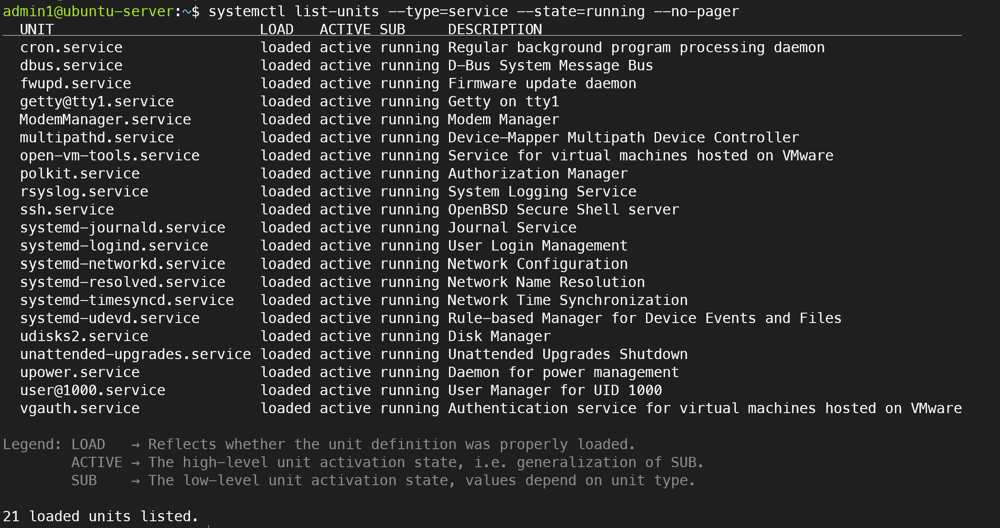
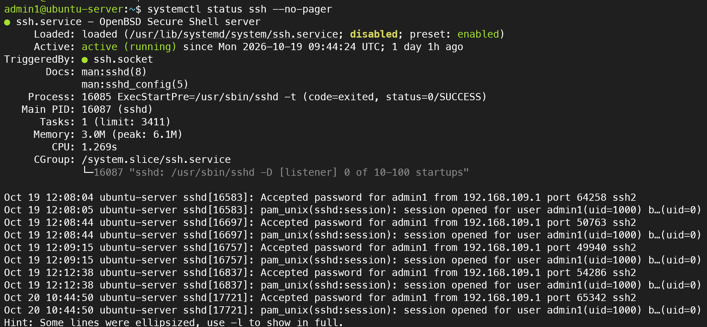
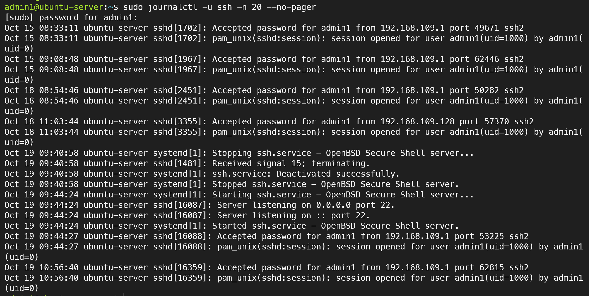
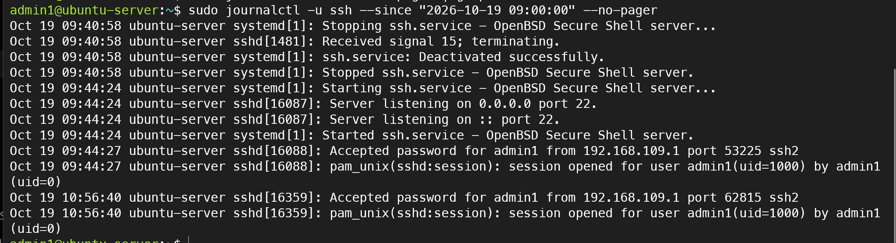
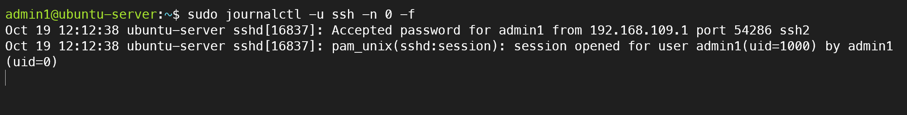

# 07. Linux 서비스 및 시스템 로그 관리

## 1. 실습 목적

Ubuntu Server 환경에서 systemd 기반 서비스의 실행 상태를 확인하고, journalctl을 이용해 시스템 로그를 분석한다. SSH 서비스의 시작·종료 기록과 사용자 접속 로그를 확인하고 실시간 로그 모니터링을 수행한다.

## 2. 실습 환경

| 항목 | 설정 |
|---|---|
| 가상화 플랫폼 | VMware Workstation Pro |
| 운영체제 | Ubuntu Server 24.04 LTS |
| 사용자 | admin1 |
| 서버 호스트명 | ubuntu-server |
| 접속 방식 | SSH (Host-only 네트워크) |

## 3. 실행 중인 서비스 확인

```bash
systemctl list-units --type=service --state=running --no-pager
```

실행 중인 서비스 21개를 확인하였다. 주요 서비스로 ssh.service, cron.service, systemd-journald.service, systemd-networkd.service 등이 실행 중이었다.



## 4. SSH 서비스 상태 확인

```bash
systemctl status ssh --no-pager
```

SSH 서비스가 active (running) 상태이며 TCP 22번 포트에서 연결을 수신하고 있음을 확인하였다.



## 5. SSH 로그 조회

```bash
sudo journalctl -u ssh -n 20 --no-pager
```

SSH 서비스의 최근 로그를 조회하여 서비스 시작·종료 기록과 admin1 계정의 접속 성공 기록을 확인하였다.



## 6. 오류 및 로그인 실패 로그 확인

```bash
sudo journalctl -u ssh -p err --no-pager
sudo journalctl -u ssh --no-pager | grep "Failed"
```

조회 결과 오류 우선순위 로그는 No entries로 표시되었고, Failed 문자열에 해당하는 로그도 검색되지 않았다.

이는 조회한 로그 범위에서 해당 조건의 기록이 없었다는 의미이다.


## 7. 특정 시간 이후 로그 확인

```bash
sudo journalctl -u ssh --since "2026-10-19 09:00:00" --no-pager
```

지정한 시간 이후의 SSH 로그를 조회하여 서비스 중지·시작 기록과 사용자 접속 성공 기록을 확인하였다.



## 8. 실시간 로그 모니터링

```bash
sudo journalctl -u ssh -n 0 -f
```

기존 로그 출력 없이 새로 발생하는 SSH 로그를 실시간으로 확인하였다. 새로운 SSH 연결을 수행한 후 Accepted password 및 session opened 메시지가 기록되는 것을 확인하였다.



## 9. 실습 결과

- systemctl을 이용해 실행 중인 서비스 및 SSH 서비스 상태 확인
- journalctl을 이용해 SSH 서비스 로그와 접속 기록 조회
- 오류 우선순위 로그 및 로그인 실패 문자열 검색
- 시간 조건을 이용한 로그 필터링
- SSH 연결 시 발생하는 로그를 실시간으로 확인

## 10. 배운 점

systemctl은 서비스의 실행 상태를 조회하고 관리하는 명령어이며, journalctl은 systemd 저널에 저장된 로그를 조회하는 명령어라는 차이를 이해하였다.

서비스가 정상 실행 중인지 확인하는 것뿐만 아니라 로그를 통해 서비스의 시작·종료 이력과 접속 기록을 분석하는 것이 서버 운영 및 장애 대응에 중요하다는 점을 학습하였다.
