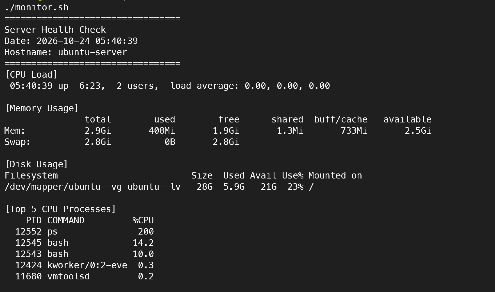
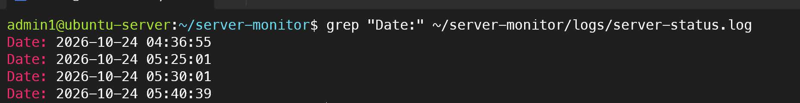

# 10. Bash 서버 모니터링 자동화

## 1. 실습 목적

Ubuntu Server 환경에서 Bash Shell Script와 cron을 활용하여 서버 상태를 자동으로 점검하고 로그 파일에 기록하는 모니터링 환경을 구축했습니다.

## 2. 실습 환경

- OS: Ubuntu Server 24.04 LTS
- 가상화: VMware Workstation Pro
- 스크립트: Bash Shell Script
- 작업 스케줄러: cron
- 모니터링 항목: CPU 부하, 메모리, 디스크, CPU 사용 프로세스

## 3. 서버 모니터링 스크립트

`monitor.sh`를 작성하여 다음 정보를 수집했습니다.

- 서버 점검 날짜 및 호스트명
- CPU Load Average
- 메모리 및 Swap 사용량
- 루트 파일시스템 디스크 사용률
- CPU 사용량 상위 5개 프로세스

스크립트에 실행 권한을 부여하고 정상 작동을 확인했습니다.

```bash
chmod +x monitor.sh
./monitor.sh
```

### 실행 결과



## 4. 로그 파일 자동 저장

점검 결과를 터미널에 출력하면서 로그 파일에도 누적 저장하도록 구성했습니다.

로그 저장 경로:

```text
/home/admin1/server-monitor/logs/server-status.log
```

`tee -a`를 사용하여 기존 기록을 유지하면서 새로운 점검 결과를 추가했습니다.

## 5. cron 자동 실행 설정

`crontab -e`를 이용하여 5분마다 스크립트가 실행되도록 등록했습니다.

```cron
*/5 * * * * /home/admin1/server-monitor/monitor.sh
```

### 자동 실행 검증 결과

```text
Date: 2026-10-24 04:36:55
Date: 2026-10-24 05:25:01
Date: 2026-10-24 05:30:01
```

05:25와 05:30에 새로운 점검 결과가 저장된 것을 확인하여 5분 간격 자동 실행이 정상 동작함을 검증했습니다.



실습 종료 후에는 불필요한 로그 누적을 방지하기 위해 테스트용 cron 작업을 제거했습니다.

## 6. 실습 결과 및 배운 점

- Bash 변수와 경로 지정 방법 이해
- Shell Script 실행 권한 설정
- CPU, 메모리, 디스크 및 프로세스 상태 수집
- `tee -a`를 이용한 로그 누적 저장
- cron을 이용한 정기 작업 자동화
- 실행 시간 비교를 통한 자동화 검증

**실습 성과:** 수동으로 확인하던 서버 상태를 Bash 스크립트로 통합하고, cron을 통해 주기적으로 실행하는 서버 점검 자동화 환경을 구현했습니다.
