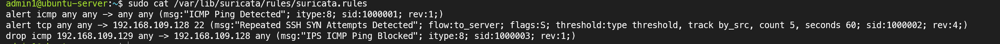
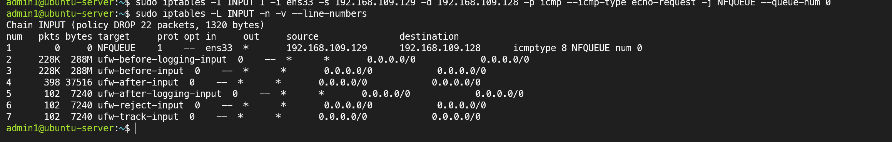
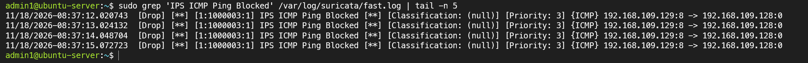
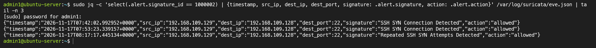
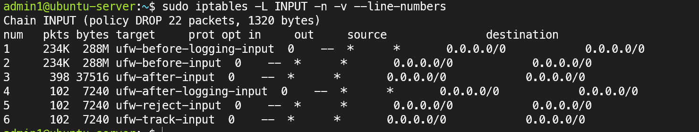
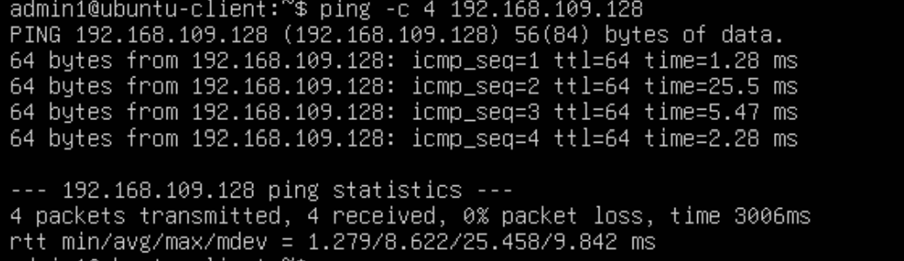

# 12. Suricata IPS 기반 네트워크 패킷 차단 실습

## 1. 실습 개요

VMware Workstation Pro 환경에서 Ubuntu Server와 Ubuntu Client를 구성하고, Suricata IPS와 iptables NFQUEUE를 이용하여 ICMP Ping 패킷을 탐지 및 차단하는 실습을 진행하였다.

기존 IDS 탐지 방식과 달리 IPS에서는 실제 패킷 차단이 가능하다는 점을 검증하였다.

## 2. 실습 환경

| 항목 | 구성 |
|---|---|
| 가상화 | VMware Workstation Pro |
| 서버 | Ubuntu Server 24.04 |
| 클라이언트 | Ubuntu Client |
| Suricata | 7.0.3 |
| 서버 IP | 192.168.109.128 |
| 클라이언트 IP | 192.168.109.129 |
| 네트워크 | Host-only |
| 인터페이스 | ens33 |
| 패킷 전달 | iptables NFQUEUE 0 |

## 3. IPS 차단 규칙

기존 IDS 규칙을 백업한 후 ICMP Echo Request를 차단하는 규칙을 추가하였다.

```suricata
drop icmp 192.168.109.129 any -> 192.168.109.128 any (msg:"IPS ICMP Ping Blocked"; itype:8; sid:1000003; rev:1;)
```

Suricata 설정 검사:

```bash
sudo suricata -T -c /etc/suricata/suricata.yaml
```

설정 파일이 정상적으로 로드되는 것을 확인하였다.

## 4. NFQUEUE 설정 및 IPS 실행

iptables INPUT 체인에 NFQUEUE 규칙을 추가하여 클라이언트에서 서버로 들어오는 ICMP Echo Request 패킷을 0번 큐로 전달하였다.

```bash
sudo iptables -I INPUT 1 -i ens33 -s 192.168.109.129 -d 192.168.109.128 -p icmp --icmp-type echo-request -j NFQUEUE --queue-num 0
```

기존 Suricata 서비스를 중지하고 IPS 방식으로 실행하였다.

```bash
sudo systemctl stop suricata
sudo suricata -c /etc/suricata/suricata.yaml -q 0
```

## 5. IPS 차단 결과

클라이언트에서 다음 명령어를 실행하였다.

```bash
ping -c 4 192.168.109.128
```

**검증 결과**

- 전송 패킷: 4개
- 수신 패킷: 0개
- 패킷 손실률: 100%

Suricata `fast.log`에서 `[Drop]` 경고를 확인하였다.

`eve.json` 로그에서는 다음 처리 결과를 확인하였다.

```json
{
  "src_ip": "192.168.109.129",
  "dest_ip": "192.168.109.128",
  "signature": "IPS ICMP Ping Blocked",
  "action": "blocked"
}
```

이를 통해 Suricata IPS가 지정된 ICMP 패킷을 실제 차단했음을 검증하였다.

## 6. IPS 종료 및 네트워크 복구

IPS 실행을 종료하고 iptables에 추가했던 NFQUEUE 규칙을 제거하였다.

이후 클라이언트에서 Ping을 재실행하였다.

- 전송 패킷: 4개
- 수신 패킷: 4개
- 패킷 손실률: 0%

기존 Suricata 서비스를 다시 실행하였다.

```bash
sudo systemctl start suricata
sudo systemctl status suricata --no-pager
```

`active (running)` 상태 및 AF_PACKET 방식 실행을 확인하였다.

## 7. 실습을 통해 학습한 내용

- IDS와 IPS의 동작 방식 차이 이해
- Suricata `alert`와 `drop` 규칙의 차이
- iptables와 NFQUEUE의 패킷 전달 구조 이해
- Suricata IPS를 이용한 ICMP 패킷 차단
- `fast.log`와 `eve.json`을 이용한 차단 결과 분석
- IPS 종료 후 네트워크 통신 및 서비스 정상 복구

이번 실습을 통해 단순히 네트워크 공격을 탐지하는 것에서 나아가, 패킷 전달 경로를 구성하고 실제 차단 결과를 검증하는 경험을 쌓았다.

## 8. 실습 검증 스크린샷

### 8.1 IPS 패킷 차단 규칙

ICMP Echo Request 패킷을 차단하는 Suricata `drop` 규칙을 작성하였다.



### 8.2 iptables NFQUEUE 설정

Ubuntu Client에서 Ubuntu Server로 전달되는 ICMP Echo Request 패킷을 NFQUEUE 0번 큐로 전달하도록 설정하였다.



### 8.3 IPS 패킷 차단 로그

Ubuntu Client에서 서버로 Ping을 전송한 결과, 패킷 손실률이 100%로 나타났다.

Suricata의 `fast.log`에서 `[Drop]` 로그를 확인하여 IPS 차단 규칙이 정상 동작했음을 검증하였다.



### 8.4 eve.json 차단 로그 분석

`jq` 명령어를 이용하여 Suricata의 `eve.json` 로그를 분석하였다.

- 출발지 IP: `192.168.109.129`
- 목적지 IP: `192.168.109.128`
- 탐지 규칙 ID: `1000003`
- 탐지 메시지: `IPS ICMP Ping Blocked`
- 처리 결과: `blocked`



### 8.5 NFQUEUE 규칙 제거

IPS 실습 종료 후 iptables에 추가했던 NFQUEUE 규칙을 제거하였다.



### 8.6 정상 통신 복구 검증

NFQUEUE 규칙 제거 후 Ubuntu Client에서 Ubuntu Server로 Ping을 다시 전송하였다.

- 전송 패킷: 4개
- 수신 패킷: 4개
- 패킷 손실률: 0%

이를 통해 IPS 차단 해제 후 정상 통신이 복구된 것을 확인하였다.



## 9. 실습 결과 및 학습 내용

이번 실습에서는 Suricata IPS와 iptables NFQUEUE를 연동하여 네트워크 패킷을 탐지하고 차단하는 과정을 검증하였다.

IDS는 탐지 및 경고를 수행하는 반면, IPS는 패킷 처리 경로에 연결되어 탐지 규칙에 따라 실제 패킷을 차단할 수 있다는 차이를 확인하였다.

특히 `fast.log`와 `eve.json`을 분석하여 패킷 차단 여부를 검증하고, NFQUEUE 규칙을 제거한 후 정상 통신이 복구되는 과정까지 확인하였다.

이를 통해 Linux 방화벽, NFQUEUE, Suricata 탐지 규칙 및 네트워크 트래픽 처리 흐름에 대한 이해를 높였다.
